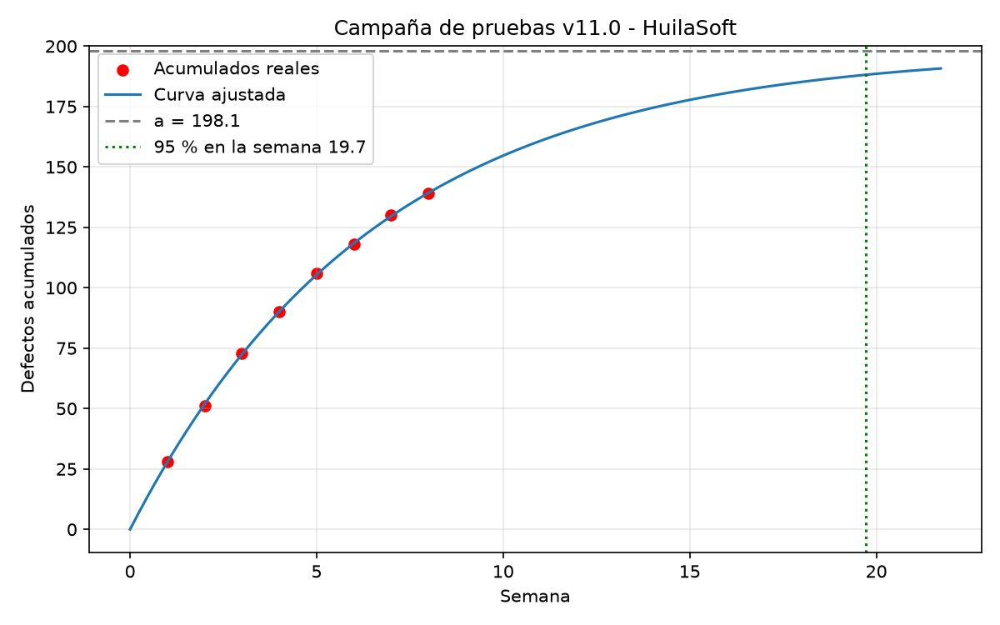

# Parcial práctico - Desarrollo de Software II

Integrantes:

- Juan Manuel Tengono Lasso - 20202193898
- Jhon Santiago Gutierrez Mosquera - 20202193073

Caso HuilaSoft . En la Parte 2 escogimos la opción B, evolución del software, con la clase `CampanaPruebas`.

## Modelo de datos

Base de datos `HuilaSoft` 

| Colección | Campo | Tipo |
|---|---|---|
| Agentes | _id | ObjectId |
| Agentes | nombre | string |
| Agentes | nivel | string |
| Agentes | ticketsh | int |
| Agentes | turno | string |
| Ticket | _id | ObjectId |
| Ticket | codigo | string |
| Ticket | minllegada | int |
| Ticket | atencion | int |
| Ticket | prioridad | string |
| Ticket | agente_id | ObjectId |
| Pruebas | _id | ObjectId |
| Pruebas | semana | int |
| Pruebas | ndefectos | int |

La relación es de uno a muchos: un agente atiende varios tickets y cada ticket guarda en `agente_id` el `_id` de su agente. `minllegada` son los minutos desde las 8:00 a. m. y `atencion` los minutos que tarda el ticket. `Pruebas` no se relaciona con las otras dos, solo guarda los defectos nuevos de cada semana.

## Parte 1: MongoDB

Los comandos que usamos en mongosh están en `mongo/script_mongosh.js` (`insertMany`, las tres consultas con `$gt` y `$lt`, `updateOne` y `deleteOne`). Las capturas están en `mongo/evidencias/` y los JSON de las colecciones en `mongo/exportaciones/`.

## Parte 2: clase CampanaPruebas

`main.py` lee la colección `Pruebas` con pymongo, crea el objeto `CampanaPruebas` y llama a sus métodos. La clase acumula los defectos por semana y usa el modelo m(t) = a(1 - e^(-bt)): `goel` calcula m(t), `ajustar` saca a y b con `curve_fit`, `restantes` calcula a - m(t), `semana_95` calcula t = ln(20)/b y `graficar` guarda la gráfica.

Con los datos del caso salió a = 198,06 y b = 0,1519. A la semana 8 hay 139 defectos acumulados, quedan unos 58,8 por encontrar y el 95 % se alcanza en la semana 19,7.



## Cómo ejecutar

```
pip install -r requirements.txt
python src/main.py
python -m pytest tests/
```


## Parte 3: interpretación

El ajuste de Goel-Okumoto da un total de unos 198 defectos (a) y una tasa de detección de 0,152 por semana (b). Hasta la semana 8 se habían encontrado 139, cerca del 70 %, así que si HuilaSoft libera la versión 11.0 hoy quedarían alrededor de 59 defectos sin descubrir. Para encontrar el 95 % haría falta llegar a t = ln 20 / b, que son unas 19,7 semanas, es decir, unas 12 semanas más de pruebas. En la gráfica se ve que los puntos reales siguen bien la curva y que esta se va aplanando: cada semana aparecen menos defectos nuevos. Nuestra recomendación es no liberar todavía, seguir probando empezando por los módulos más críticos de MatriculApp y decidir la fecha de salida según el riesgo que la empresa quiera asumir.
